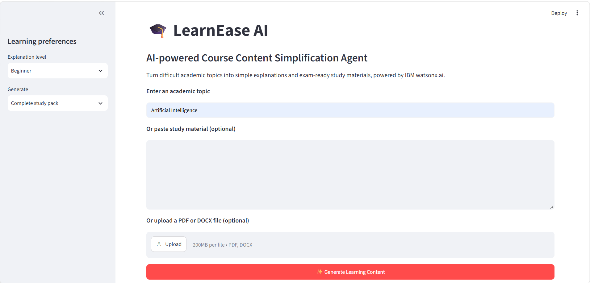
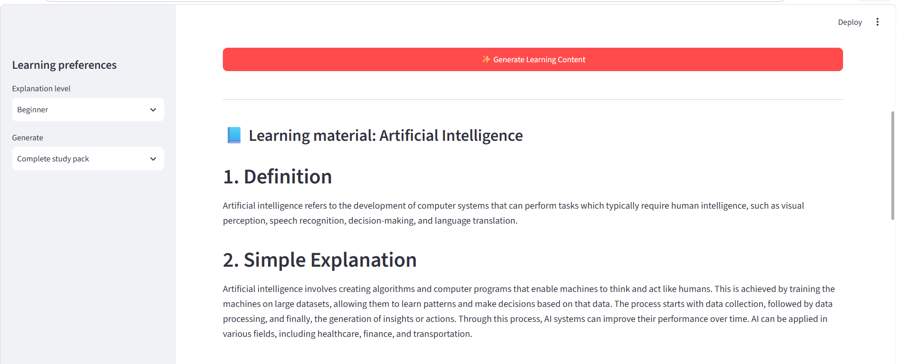
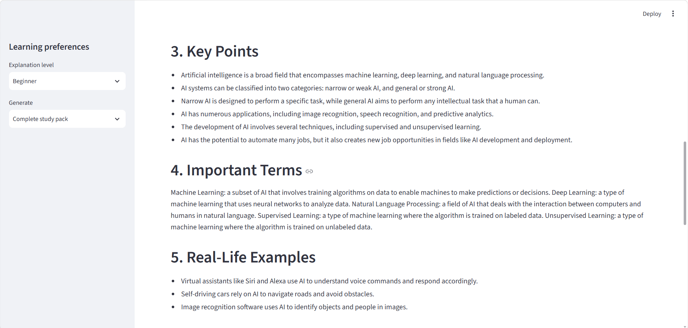
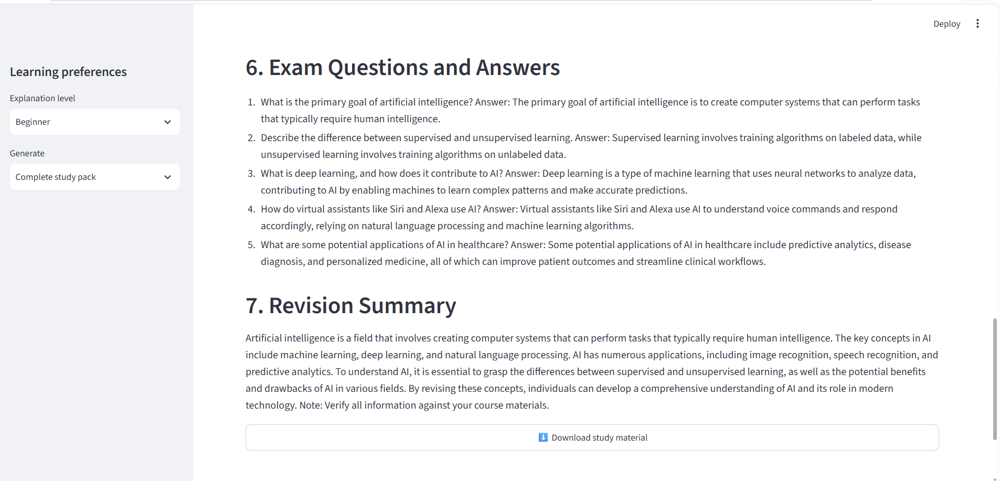

# LearnEase AI 📚
### AI-Powered Course Content Simplification Agent

LearnEase AI is an AI-powered learning assistant that transforms complex academic topics and study materials into simple, structured, and exam-oriented learning content.

## 🎯 Problem Statement

College students often struggle to understand lengthy and technical study materials. Preparing simplified notes, examples, and practice questions manually can be time-consuming.

LearnEase AI aims to make learning easier by converting complex content into clear explanations and structured study resources.

## ✨ Key Features

- **Content Simplification:** Explains complex topics in student-friendly language.
- **Structured Study Notes:** Generates definitions, key points, and important terms.
- **Real-Life Examples:** Provides examples to improve conceptual understanding.
- **Exam Preparation:** Generates practice questions and answers.
- **Revision Summary:** Creates concise summaries for quick revision.
- **Multiple Input Options:** Accepts academic topics, pasted text, PDF, and DOCX files.
- **Learning Levels:** Supports different learner levels.

## 🛠️ Technologies Used

- Python
- Streamlit
- IBM watsonx.ai Runtime
- Llama 3.3 70B Instruct
- REST API
- Requests
- PyMuPDF
- python-docx

## 🖥️ Application Screenshots

### 1. Homepage


### 2. User Input


### 3. Generated Study Pack


### 4. Important Terms and Examples


### 5. Exam Questions and Revision


## ⚙️ Installation and Setup

1. Clone the repository:

   ```bash
   git clone https://github.com/Swapnika2229/LearnEase-AI.git
   ```

2. Navigate to the project directory:

   ```bash
   cd LearnEase-AI
   ```

3. Install dependencies:

   ```bash
   pip install -r requirements.txt
   ```

4. Create a `.env` file and configure your IBM watsonx.ai credentials using the variable names expected by `granite_client.py`.

5. Run the application:

   ```bash
   streamlit run app.py
   ```

## 🔐 Responsible AI

AI-generated content may contain errors. Users should verify important information using textbooks, academic resources, and faculty notes.

## 🚀 Future Scope

- Multilingual learning support
- Personalized learning recommendations
- Voice-based interaction
- Retrieval-Augmented Generation (RAG)
- Additional academic document formats

## 👩‍💻 Developer

**Swapnika Mohanty**  
B.Tech – Computer Science and Engineering  
Chaitanya Deemed To Be University

## 🔗 Repository

[LearnEase AI – GitHub](https://github.com/Swapnika2229/LearnEase-AI)